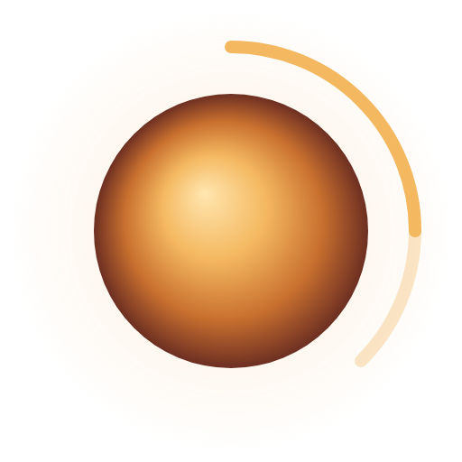
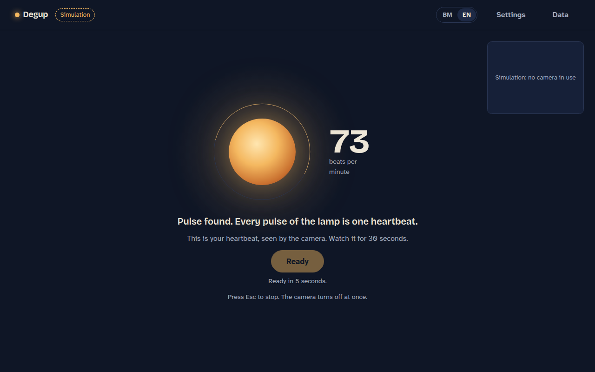
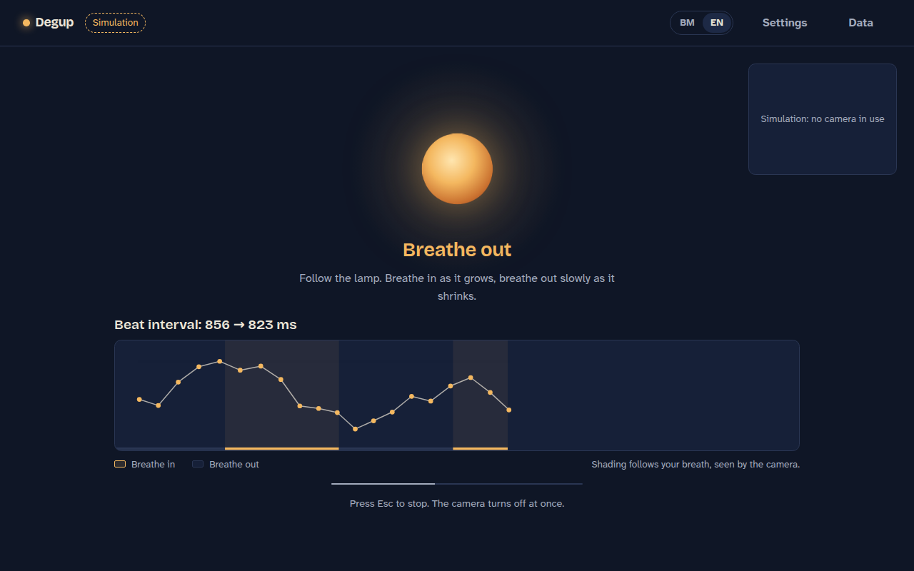
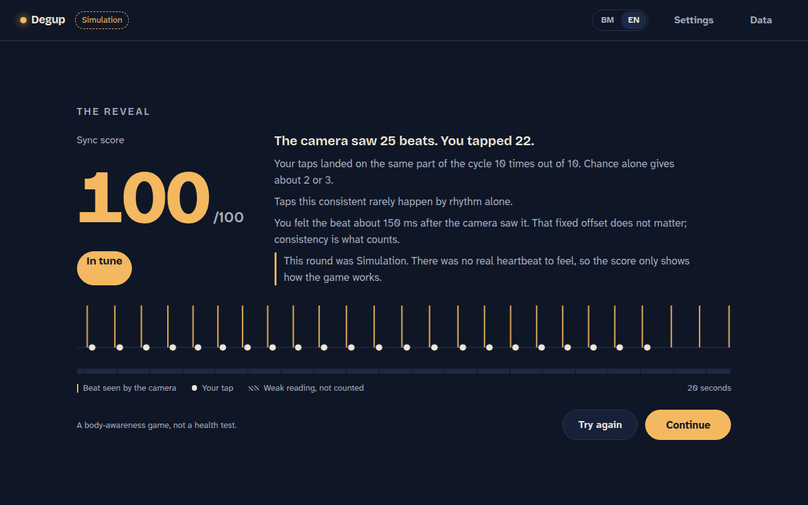
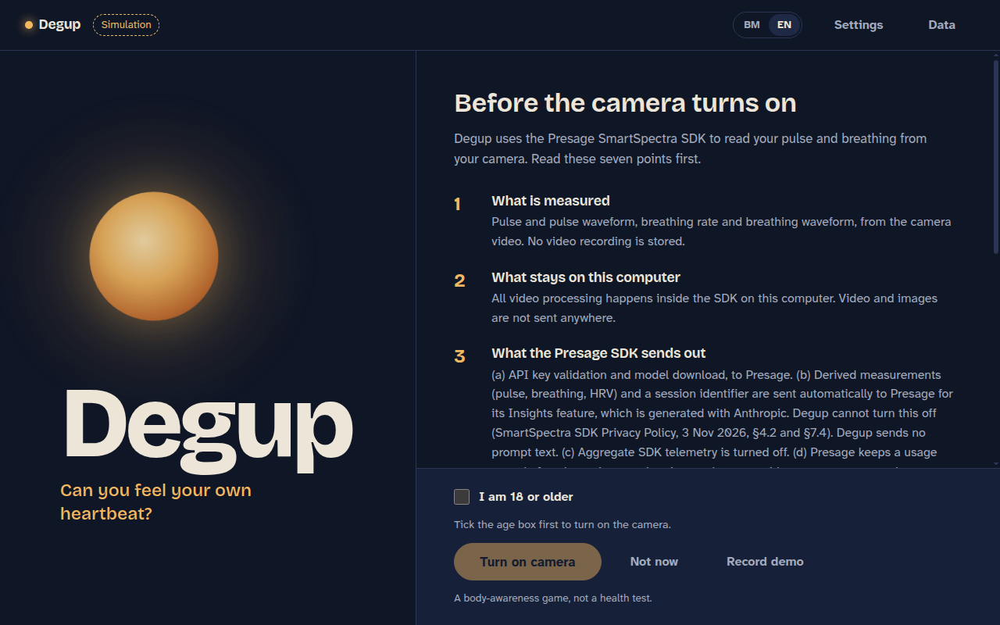
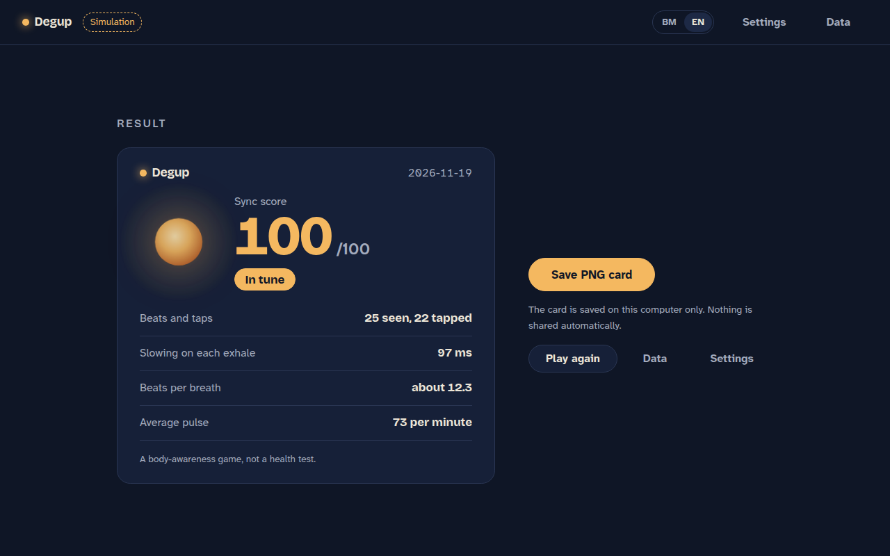

<p align="center"></p>

<h1 align="center">Degup</h1>

<p align="center">   </p>

<p align="center"><b>Can you feel your own heartbeat? A three-minute webcam game that checks.</b> · <i>Boleh kau rasa degupan jantung sendiri? Permainan kamera web tiga minit yang menyemaknya.</i><br>
<a href="#run-it-in-one-command">Run it</a> · <a href="#how-it-meets-the-judging-criteria">How it meets the judging criteria</a> · <a href="#code-map-for-reviewers">Code map</a> · <a href="#tests-and-what-was-measured">Tests</a> · <a href="#limits">Limits</a> · <a href="#consent-and-data">Consent and data</a> · <a href="README.ms.md">Bahasa Melayu</a><br>
Built in Malaysia by <a href="https://aimanmalib.com">Aiman Malib</a> · <a href="https://sasateguh.com">Sasa Teguh</a></p>

Degup is a desktop game for adults. A normal webcam and the Presage SmartSpectra SDK see your pulse, and then the game asks
whether you can feel that same beat yourself.


*Every picture in this README is the real app in simulation mode: simulated signal, no camera, no key. The "Simulation" label at
the top of each screen is the app's own.*

## The problem and the idea

Most people cannot say when their heart beats unless they put a finger on their wrist. Sensing your own body from the inside
has a name, interoception, and researchers have tested it for years with tapping tasks: you tap when you feel a beat, and a
sensor checks the timing. That needed a chest strap or a finger clip, so it stayed in the lab.

<!-- izin mula -->
A body-awareness game, not a health test.
<!-- izin akhir -->

Degup moves that check onto any laptop. The SmartSpectra SDK reads the pulse waveform from the camera, Degup finds each beat in
that waveform, and your taps are scored against it. There is no right answer to chase. You find out how well you feel your own
heart today, and you see your breathing pull the beat faster and slower in real time.

## How it works

The game has three scenes, about three minutes in total. Lengths come from `config/app.json` (`aliran`).

1. **See (30 s).** A lamp pulses once for every heartbeat the camera sees. The beats come from the SDK's arterial pressure waveform
   (`cardio.arterialPressureTrace`). The SDK payload has no beat markers, so Degup finds them itself in
   [`src/core/beats.ts`](src/core/beats.ts): detrend, low-pass filter, adaptive threshold, and a 330 ms refractory window. Beats
   in a weak reading are marked and left out.
2. **Feel (40 s).** The lamp goes dark. You press Space each time you feel a beat, without touching your pulse. Then the reveal
   draws your taps under the beats the camera saw. The sync score is about consistency, not delay: each tap gets a position in
   its beat cycle, and the score is how tightly those positions cluster (mean resultant length R plus a Rayleigh test;
   [`src/core/score.ts`](src/core/score.ts)). A fixed lag of 150 ms every time still counts as in tune. A steady rhythm can also
   cluster, so the bands are set from tappers who feel nothing ([`docs/MEASUREMENTS.md`](docs/MEASUREMENTS.md)), and a round counts
   only when the taps cover most of it: fewer than 20 taps or less than 30 seconds gives "Too few taps to tell".
3. **Bend (60 s).** You breathe in for 4 seconds and out for 6, following the lamp. The gap between beats is drawn live, shaded
   by the breath. Most people see the beat slow down on each out-breath. Degup reports the size of that swing in milliseconds
   and how many beats fit in one breath, computed from the SDK pulse and breathing rates ([`src/core/rsa.ts`](src/core/rsa.ts)).

| SDK signal (3.4.0) | What Degup does with it |
|---|---|
| `cardio.arterialPressureTrace` | Beat detection for the lamp, the reveal and the beat gaps in Bend |
| `cardio.pulseRate` | Self-check: if the detected beat rate differs from the SDK by more than 10%, the beats are flagged as noisy |
| `breathing.upperTrace` | Breath shading in Bend, from your real breath when the trace is steady |
| `cardio.pulseRate` ÷ `breathing.rate` | "About N beats per breath" on the Bend and result screens, computed by Degup from the latest steady values |
| Signal confidence | Weak seconds are shaded on the timeline and not scored |

<p align="center"> </p>

*See (left) and Bend (right), simulated signal, no camera.*



*The reveal, simulated signal, no camera. The 100/100 score comes from taps that the screenshot script placed in phase with the
simulated beats on purpose. A person tapping by feel scores lower.*

Built for the Presage SmartSpectra SDK Challenge on DEV (November 2026). First commit:
`50def1be6dd669eac62371ec66c7c7c72d9648e3` (8 Nov 2026 UTC).

## Run it in one command

This path needs no camera and no Presage key. It runs the full game on the built-in synthetic signal (`sim`). You need Git and
Node.js 22 (`.nvmrc`). `npm ci` downloads Electron and the SDK's native packages for every platform, about 370 MB.

Bash (Linux, macOS):

```bash
git clone https://github.com/aimanmalib/degup.git && cd degup && npm ci && DEGUP_SUMBER=sim npm start
```

On Linux, Electron run from source can stop at once with a "SUID sandbox helper" error (it did on the Ubuntu host I tested
on). Start it with the sandbox switch instead: `DEGUP_SUMBER=sim npm start -- --no-sandbox`.

PowerShell (Windows):

```powershell
git clone https://github.com/aimanmalib/degup.git; cd degup; npm ci; $env:DEGUP_SUMBER = "sim"; npm start
```

The window opens on the consent screen in Bahasa Melayu. Switch to English with the **BM / EN** toggle at the top. Tick the age
box and continue; in `sim` mode the camera is never opened. Space taps in Feel. Esc stops a round.

To replay a recorded session of numbers instead of the generator, use `DEGUP_SUMBER=replay`. The repo ships one example
fixture, `fixtures/sim-contoh.json`, which is itself synthetic. Fixtures hold numbers only, never images.

## Live mode with your own free Presage key

Live mode is the real thing: your camera, the SDK, your pulse.

1. Get a free key at [physiology.presagetech.com](https://physiology.presagetech.com/auth/register).
2. Start the app without `DEGUP_SUMBER` (`npm start`). Open **Settings**, paste the key and save. It is stored encrypted with
   Electron `safeStorage` in your user folder. When you run from source you can also set `SMARTSPECTRA_API_KEY` in the shell
   environment instead (`.env.example` shows the name; the app does not read `.env` by itself).
3. Sit facing a light, one person in the frame, and follow the consent screen.

On Linux without a Vulkan GPU driver, Degup points the SDK at Mesa lavapipe (`sdk.vulkan_icd_linux` in `config/app.json`).

Honest status: the live code path exists ([`src/sumber/live.ts`](src/sumber/live.ts), with the camera owned by the renderer as in
the official `electron-quickstart` sample) and its wiring is unit tested against a fake SDK. A smoke test with a fake camera and no
face confirmed the key, the SDK bridge and the no-face hint ([`docs/MEASUREMENTS.md`](docs/MEASUREMENTS.md)). It has not yet been
measured on a real face. See [Limits](#limits).

## How it meets the judging criteria

| Criterion or requirement | Where to look |
|---|---|
| **Use of Underlying Technology** | The SDK is the only source of the pulse and breath. Beats are found in the raw `cardio.arterialPressureTrace` ([`src/core/beats.ts`](src/core/beats.ts)), checked against `cardio.pulseRate`, and scored ([`src/core/score.ts`](src/core/score.ts)). Breathing drives Bend ([`src/core/rsa.ts`](src/core/rsa.ts)). SDK setup: [`src/sumber/live.ts`](src/sumber/live.ts) |
| **Usability and User Experience** | Three short scenes, one key to play. Bilingual from day one: every UI string lives in [`lang/en.json`](lang/en.json) and [`lang/ms.json`](lang/ms.json). Weak readings are shown, not hidden. A Data panel counts what actually left the app in this session ([`src/renderer/skrin/data.ts`](src/renderer/skrin/data.ts)) |
| **Originality and Creativity** | It turns a lab interoception task into a webcam game, scores the feeling of a beat rather than the beat, and makes the breath visible as it bends the heart rhythm |
| SDK at the core, at least one live signal | Pulse waveform, pulse rate and breathing drive all three scenes |
| Public repo with install steps | [Run it in one command](#run-it-in-one-command) (the owner makes the repo public before the deadline) |
| Demo video | Not recorded yet, see [Limits](#limits) |
| Camera consent and data handling | [Consent and data](#consent-and-data), the consent screen ([`src/renderer/skrin/izin.ts`](src/renderer/skrin/izin.ts)) and its text in [`lang/en.json`](lang/en.json) (`izin`) |



## Consent and data

The camera stays off until you have read the consent screen and ticked "I am 18 or older". Esc turns it off at once. The SDK is
set up in [`src/sumber/live.ts`](src/sumber/live.ts) with only the cardio and breathing metric groups,
`enableTelemetry: false`, `enableAccumulatedOutput: false`, and exactly one `metrics` listener. Degup never asks the SDK for
Insights. The Data panel shows, for the current session, whether the key was validated, how many automatic Insights events
arrived, that telemetry is off, that Degup sent zero video frames, and which files it wrote.

This is the consent text the app shows, copied from [`lang/en.json`](lang/en.json):

<!-- izin mula -->
> **Before the camera turns on.** Degup uses the Presage SmartSpectra SDK to read your pulse and breathing from your camera.
>
> 1. **What is measured.** Pulse and pulse waveform, breathing rate and breathing waveform, from the camera video. No video
>    recording is stored.
> 2. **What stays on this computer.** All video processing happens inside the SDK on this computer. Video and images are not
>    sent anywhere.
> 3. **What the Presage SDK sends out.** (a) API key validation and model download, to Presage. (b) Derived measurements (pulse,
>    breathing, HRV) and a session identifier are sent automatically to Presage for its Insights feature, which is generated with
>    Anthropic. Degup cannot turn this off (SmartSpectra SDK Privacy Policy, 3 Nov 2026, §4.2 and §7.4). Degup sends no prompt
>    text. (c) Aggregate SDK telemetry is turned off. (d) Presage keeps a usage record of each session: session time and counts,
>    without measurement values (§4.4). Presage keeps this data while the developer account behind the API key is active, and
>    deletes it within 60 days after that account is closed (§10.1(b)).
> 4. **What Degup keeps.** A settings file and your API key, stored encrypted with Electron safeStorage in your user folder. No
>    scores are stored. A PNG card is saved only when you press Save PNG card, and a demo video only when you press Record demo.
> 5. **Who it is for.** Adults aged 18 and over. One person in the frame.
> 6. **Not a medical device.** This is a body-awareness game. It does not diagnose, treat or monitor any condition. SDK
>    measurements are for general wellness and are not FDA cleared for diagnosis.
> 7. **Short terms.** No warranty, on behalf of Degup and Presage. Do not reverse engineer the SDK. Do not use it for diagnosis
>    or treatment.
<!-- izin akhir -->

Presage documents: [privacy policy](https://presagetech.com/legal/privacy-policy) and
[terms of service](https://presagetech.com/legal/terms-of-service). The result card (PNG) is saved on your computer only when you
press Save; nothing is shared automatically.



## Architecture

```text
src/core/      pure TypeScript: beat detection, sync score, Bend, fixtures, i18n (no DOM, no SDK)
src/sumber/    three signal sources with one interface: live (SDK) | replay (fixture) | sim (generator)
src/renderer/  Electron renderer: camera, scenes, consent, Settings, Data panel, demo recorder
src/main/      Electron main: window, safeStorage key, local files, SDK environment
config/        every value that may change: scene lengths, thresholds, score bands, breathing pace, links
lang/          every UI string, Bahasa Melayu and English, same keys
```

The game logic never knows where the numbers come from. `sim` and `replay` emit the same payload shape as the SDK, so the
tests and the screenshots run the same code path as a live session, minus the camera. Timestamps stay in the SDK's
microseconds since epoch, and taps are stamped on the same clock, so pipeline latency does not shift the score.

## Code map for reviewers

| File | What it does |
|---|---|
| [`src/sumber/live.ts`](src/sumber/live.ts) | SDK setup: cardio and breathing only, telemetry off, one `metrics` listener, error codes to messages |
| [`src/renderer/sdk-live.ts`](src/renderer/sdk-live.ts) | The real SDK factory: `SmartSpectraSDK` from the renderer entry plus `decodeMetrics` |
| [`src/main/sdk.ts`](src/main/sdk.ts) | Main process: `bindSmartSpectraIpc` loaded only for live mode, native library path, Vulkan on Linux |
| [`src/core/beats.ts`](src/core/beats.ts) | Beat detection on `cardio.arterialPressureTrace`, the SDK's raw pulse waveform |
| [`src/core/stabil.ts`](src/core/stabil.ts) | Pulse rate, confidence and stable time for the See screen |
| [`src/core/score.ts`](src/core/score.ts) | Sync score: tap phase, mean resultant length, Rayleigh test, bands and the coverage rule |
| [`src/core/rsa.ts`](src/core/rsa.ts) | Bend maths: beat gaps grouped by breathing cycle |
| [`src/core/lentur.ts`](src/core/lentur.ts) | Bend collector and result rows, including beats per breath |
| [`src/sumber/sim.ts`](src/sumber/sim.ts) | The simulated source: a synthetic payload in the SDK's shape with known beat times |
| [`lang/en.json`](lang/en.json) | Every English string, including the consent text word for word |

## Glossary (Malay to English)

File and identifier names are in Malay. These are the ones you will meet most.

| Malay | English | Malay | English |
|---|---|---|---|
| `sumber` | signal source | `teras` | core |
| `degupan` | beats | `ketukan` | taps |
| `nadi` | pulse | `nafas` | breathing |
| `lihat` | See (scene 1) | `rasa` | Feel (scene 2) |
| `lentur` | Bend (scene 3) | `dedah` | reveal |
| `keputusan` | result | `izin` | consent |
| `tetapan` | settings | `babak` | scene |
| `skor` | score | `jalur` | band |
| `ambang` | threshold | `keyakinan` | confidence |
| `stabil` | stable | `sela` | interval |
| `petunjuk` | hint | `pelita` | the light circle |
| `rakaman`, `perakam` | recording, recorder | `kad` | result card |
| `pemancar` | emitter | `pendengar` | listener |
| `kilang` | factory | `nyahkod` | decode |
| `simpanan` | local storage | `ralat` | error |
| `gerbang` | gate (checks before commit) | `ujian` | test |
| `kata larangan` | banned words | `ukur` | measure |

## Tests and what was measured

The gate is [`scripts/gerbang-ujian.sh`](scripts/gerbang-ujian.sh): file size limits, `tsc` for main and renderer, vitest,
an esbuild build, then Playwright driving the built Electron app under xvfb in `sim` mode. On 19 November 2026 it passed on Depot CI,
run `7m3kh0vmj7`: 126 unit tests and 12 Electron tests, with 1 skipped (the screenshot script for this README, which runs only on request).

What the tests assert, all on synthetic signals with a known answer:

- **Beat detector** ([`tests/beats.test.ts`](tests/beats.test.ts)): at 55 to 95 beats per minute across seven seeds, at least 95% of
  true beats found, median timing error under 40 ms, no two beats inside the refractory window. Also the pulse rate self-check
  and gaps.
- **Sync score** ([`tests/score.test.ts`](tests/score.test.ts)): taps in phase land in "In tune", random taps land in "Guessing"
  across several seeds, half and half lands in "Some sense", under 10 taps gives no score, taps in only the first 12 seconds give
  "Too few taps to tell".
- **A tapper who feels nothing** ([`tests/pengetuk-tidak-merasa.test.ts`](tests/pengetuk-tidak-merasa.test.ts)): six seeded tapper
  models, 2,000 rounds each, through the real score. Random tappers reach "Some sense" or above in at most 10% of rounds, a steady
  rhythm at the pulse rate in at most 20%, "In tune" at most 5%; tappers who feel reach it in at least 80% (weak) and 99% (clear).
- **Bend** ([`tests/rsa.test.ts`](tests/rsa.test.ts)): with a known breathing swing of 3 to 6 beats per minute, the reported swing
  is within 10% of the reference.
- **SDK payload shape** ([`tests/bentuk-metrics.test.ts`](tests/bentuk-metrics.test.ts)): sim and replay payloads go through
  the installed SDK's own `Metrics` encoder and `decodeMetrics` with nothing lost, and the decoded stream yields beats, pulse and
  beats per breath. A field the SDK does not have fails here.
- **SDK setup** ([`tests/live.test.ts`](tests/live.test.ts)): cardio and breathing only, telemetry off, exactly one `metrics`
  listener, no Insights request anywhere in `src/`, against a fake SDK.
- **Words** ([`tests/kata-larangan.test.ts`](tests/kata-larangan.test.ts)): UI text and both READMEs are checked for a list of
  words that would turn a game into a health claim. They may appear only inside the consent block.
- **Language parity** ([`tests/pariti-lang.test.ts`](tests/pariti-lang.test.ts)): same keys and placeholders in both languages.
- **Electron flow** ([`e2e/`](e2e/)): the full game in `sim` and in `replay`, pauses when the reading drops, the PNG card, Play
  again, settings and the demo recorder.

## Limits

- **Live mode is not measured yet.** No run on a real face is recorded in [`docs/MEASUREMENTS.md`](docs/MEASUREMENTS.md). The
  detector numbers above are on synthetic signals only, which are not physiology. How many beats the detector misses in dim
  light, and on which webcams, is unknown.
- **No installer.** There is no Windows or macOS build to download. Run from source.
- **Checked on Linux only.** The bash command was checked from a clean clone (`git archive`) on Linux under xvfb on 17 November
  2026: `npm ci` passed and the app ran in `sim` mode, with `--no-sandbox` because of the Electron sandbox error above. The
  PowerShell line and macOS have not been run.
- **No demo video yet.**
- **Linux needs Vulkan** for the SDK; without a GPU driver it uses Mesa lavapipe, which is slower.
- **The SDK sends derived measurements to Presage for Insights** in live mode, and Degup cannot switch that off. It is point 3
  of the consent screen.
- It is a game. It does not tell you anything about your heart beyond what you see on screen.

## Credits

- The renderer owns the camera and hands the stream to the SDK, following the official `electron-quickstart` sample in
  [Presage-Security/SmartSpectra](https://github.com/Presage-Security/SmartSpectra) (`nodejs/samples/electron-quickstart`).
- The tapping idea is inspired by the Phase Adjustment Task ([Plans et al., 2021](https://doi.org/10.1016/j.biopsycho.2021.108171)).
  Inspiration only; Degup is not a validated version of it.
- Fonts: Bricolage Grotesque and Atkinson Hyperlegible Next (SIL Open Font License), bundled from `@fontsource`.

## AI disclosure

Degup was built with Claude Code. Claude agents, working under my standing project rules, wrote the spec, the code, the tests
and the first draft of the DEV post. A separate Claude session reviews the work before I submit. I approved the look of the app.
The build ran as many Claude Code sessions on my own server; the transcripts carry that server's private setup, so they are not
published. The app itself does not call an AI model.
In live mode the Presage SDK sends derived measurements to Presage for its Insights feature, which Presage generates with
Anthropic; Degup cannot turn that off and says so on the consent screen.

## License

MIT, see [LICENSE](LICENSE). The Presage SmartSpectra SDK has its own license and terms.

## Work with Sasa Teguh

I built this project. I run [Sasa Teguh](https://sasateguh.com), a studio in Malaysia that builds websites found on Google and in AI answers, and sets up systems like this one for businesses.

[Book a call](https://sasateguh.com/book) · hello@sasateguh.com · [More from Sasa Teguh](https://github.com/sasateguh)
