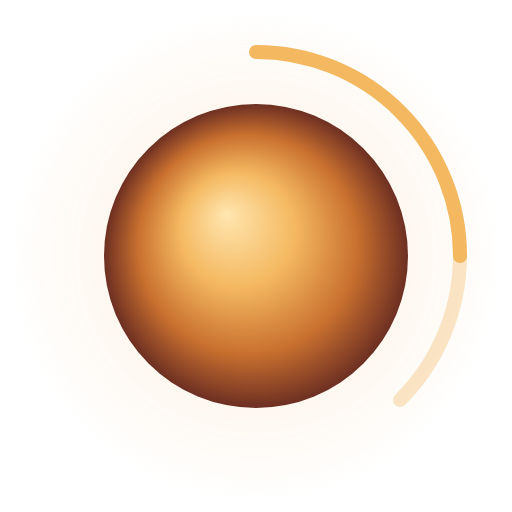
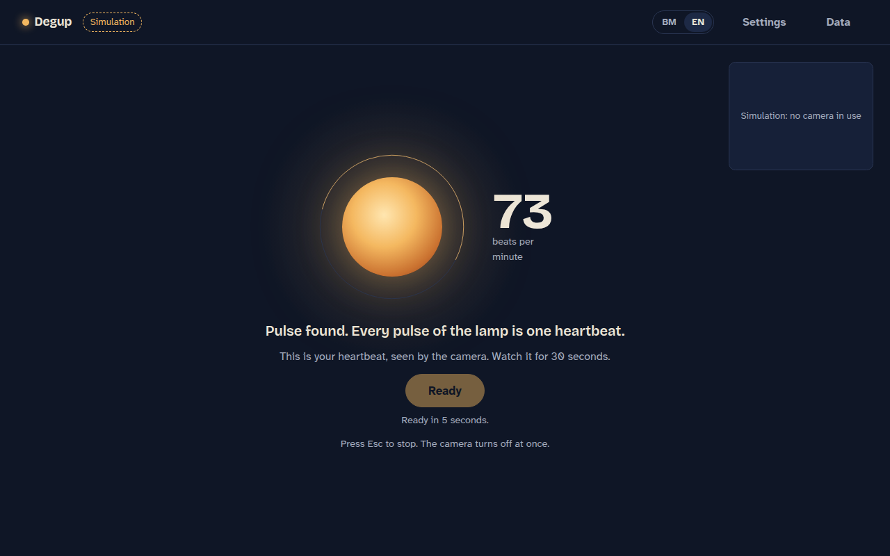
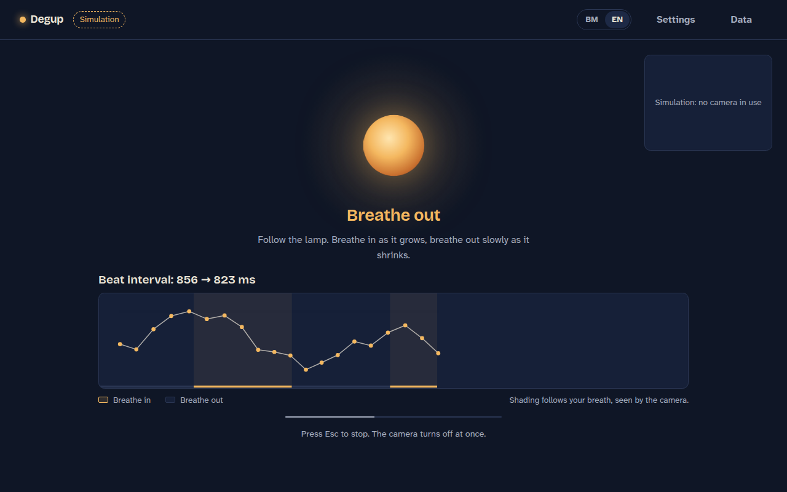
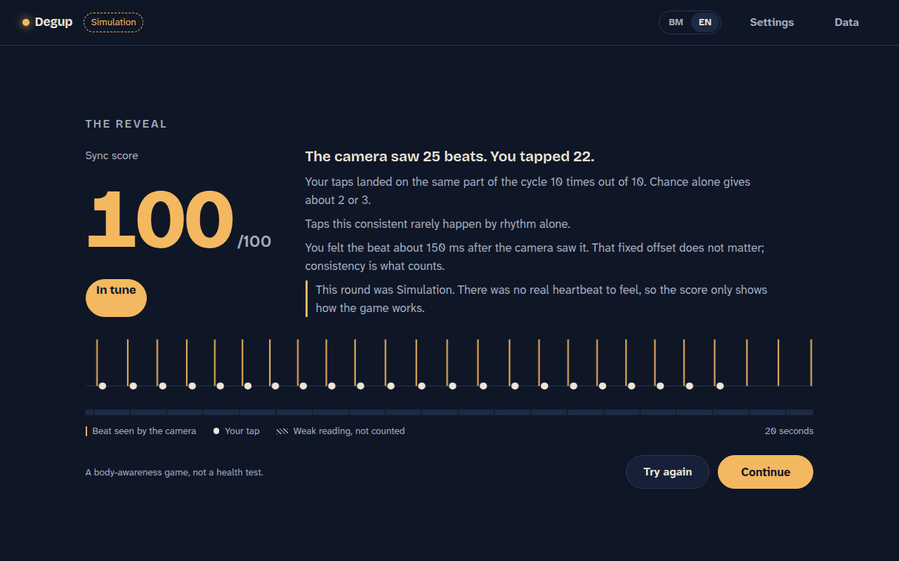
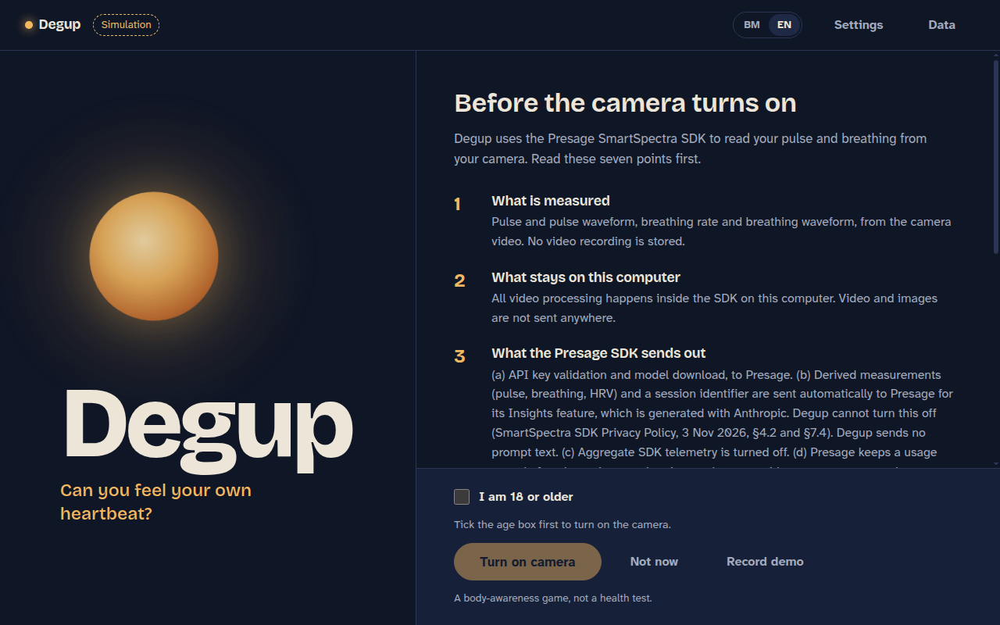
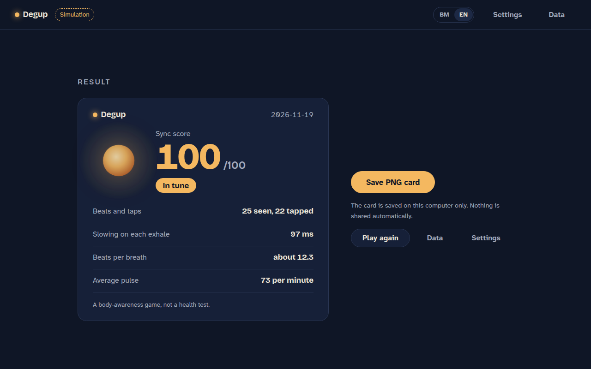

<p align="center"></p>

<h1 align="center">Degup</h1>

<p align="center">   </p>

<p align="center"><b>Boleh kau rasa degupan jantung sendiri? Permainan kamera web tiga minit yang menyemaknya.</b> · <i>Can you feel your own heartbeat? A three-minute webcam game that checks.</i><br>
<a href="#jalankan-dengan-satu-arahan">Jalankan</a> · <a href="#bagaimana-ia-memenuhi-kriteria-juri">Kriteria juri</a> · <a href="#peta-kod-untuk-penilai">Peta kod</a> · <a href="#ujian-dan-apa-yang-diukur">Ujian</a> · <a href="#had">Had</a> · <a href="#izin-dan-data">Izin dan data</a> · <a href="README.md">English</a><br>
Dibina di Malaysia oleh <a href="https://aimanmalib.com">Aiman Malib</a> · <a href="https://sasateguh.com">Sasa Teguh</a></p>

Ini terjemahan Bahasa Melayu. [README.md](README.md) dalam bahasa Inggeris ialah versi rujukan; Bahasa Melayu untuk pautan ini.

Degup ialah permainan desktop untuk orang dewasa. Kamera web biasa dan Presage SmartSpectra SDK melihat nadi kau, kemudian
permainan bertanya sama ada kau dapat merasa degupan yang sama itu sendiri.


*Setiap gambar dalam README ini ialah app sebenar dalam mod simulasi: isyarat simulasi, tiada kamera, tiada kunci. Label
"Simulation" di atas setiap skrin dipaparkan oleh app sendiri. Gambar diambil dalam antara muka Inggeris.*

## Masalah dan idea

Kebanyakan orang tidak dapat berkata bila jantung mereka berdegup tanpa meletakkan jari di pergelangan tangan. Merasa badan
sendiri dari dalam ada namanya, interosepsi, dan penyelidik sudah lama mengujinya dengan tugas mengetuk: kau mengetuk bila
merasa degupan, dan sensor menyemak masanya. Itu memerlukan tali dada atau klip jari, jadi ia kekal di makmal.

<!-- izin mula -->
Permainan rasa tubuh, bukan ujian kesihatan.
<!-- izin akhir -->

Degup membawa semakan itu ke mana-mana komputer riba. SmartSpectra SDK membaca gelombang nadi dari kamera, Degup mencari setiap
degupan dalam gelombang itu, dan ketukan kau diskor terhadapnya. Tiada jawapan betul untuk dikejar. Kau tahu sejauh mana kau
merasa jantung sendiri hari ini, dan kau nampak pernafasan menarik degupan menjadi laju dan perlahan pada masa nyata.

## Cara ia berfungsi

Permainan ini ada tiga babak, kira-kira tiga minit semuanya. Tempoh datang dari `config/app.json` (`aliran`).

1. **Lihat (30 s).** Pelita berdenyut sekali untuk setiap degupan yang kamera lihat. Degupan datang dari gelombang tekanan
   arteri SDK (`cardio.arterialPressureTrace`). Payload SDK tiada penanda degupan, jadi Degup mencarinya sendiri dalam
   [`src/core/beats.ts`](src/core/beats.ts): buang aliran, penapis laluan rendah, ambang menyesuai, dan tetingkap refraktori
   330 ms. Degupan dalam bacaan lemah ditanda dan tidak dikira.
2. **Rasa (40 s).** Pelita padam. Kau menekan Space setiap kali merasa degupan, tanpa menyentuh nadi. Kemudian pendedahan
   melukis ketukan kau di bawah degupan yang kamera lihat. Skor selaras ialah tentang ketekalan, bukan kelewatan: setiap ketukan
   diberi kedudukan dalam kitaran degupannya, dan skor ialah betapa rapat kedudukan itu berkumpul (panjang resultan min R dan
   ujian Rayleigh; [`src/core/score.ts`](src/core/score.ts)). Kelewatan tetap 150 ms setiap kali tetap dikira selaras. Rentak
   tetap juga boleh berkumpul, jadi jalur ditetapkan daripada pengetuk yang tidak merasa apa-apa
   ([`docs/MEASUREMENTS.md`](docs/MEASUREMENTS.md)), dan pusingan dikira hanya bila ketukan meliputi sebahagian besarnya: kurang
   daripada 20 ketukan atau kurang daripada 30 saat memberi "Terlalu sedikit untuk dinilai".
3. **Lentur (60 s).** Kau tarik nafas 4 saat dan hembus 6 saat, mengikut pelita. Jarak antara degupan dilukis hidup, berlorek
   ikut nafas. Kebanyakan orang nampak degupan menjadi perlahan pada setiap hembusan. Degup melaporkan saiz ayunan itu dalam
   milisaat dan berapa degupan dalam satu nafas, dikira dari kadar nadi dan kadar nafas SDK ([`src/core/rsa.ts`](src/core/rsa.ts)).

| Isyarat SDK (3.4.0) | Apa Degup buat dengannya |
|---|---|
| `cardio.arterialPressureTrace` | Pengesanan degupan untuk pelita, pendedahan dan jarak degupan dalam Lentur |
| `cardio.pulseRate` | Semakan kendiri: jika kadar degupan yang dikesan berbeza lebih 10% dari SDK, degupan ditanda bising |
| `breathing.upperTrace` | Lorek nafas dalam Lentur, dari nafas sebenar kau bila jejaknya stabil |
| `cardio.pulseRate` ÷ `breathing.rate` | "Kira-kira N degupan setiap nafas" pada skrin Lentur dan keputusan, dikira Degup dari nilai stabil terkini |
| Keyakinan isyarat | Saat yang lemah dilorek pada garis masa dan tidak diskor |

<p align="center"> </p>

*Lihat (kiri) dan Lentur (kanan), isyarat simulasi, tiada kamera.*



*Pendedahan, isyarat simulasi, tiada kamera. Skor 100/100 datang dari ketukan yang skrip tangkapan skrin letakkan sefasa dengan
degupan simulasi dengan sengaja. Orang yang mengetuk ikut rasa mendapat skor lebih rendah.*

Dibina untuk Presage SmartSpectra SDK Challenge di DEV (November 2026). Komit pertama:
`50def1be6dd669eac62371ec66c7c7c72d9648e3` (8 Nov 2026 UTC).

## Jalankan dengan satu arahan

Jalan ini tidak memerlukan kamera atau kunci Presage. Ia menjalankan permainan penuh atas isyarat sintetik terbina (`sim`). Kau
perlukan Git dan Node.js 22 (`.nvmrc`). `npm ci` memuat turun Electron dan pakej asli SDK untuk setiap platform, kira-kira 370 MB.

Bash (Linux, macOS):

```bash
git clone https://github.com/aimanmalib/degup.git && cd degup && npm ci && DEGUP_SUMBER=sim npm start
```

Di Linux, Electron yang dijalankan dari sumber boleh berhenti serta-merta dengan ralat "SUID sandbox helper" (ia berlaku pada
hos Ubuntu tempat aku menguji). Mulakan dengan suis kotak pasir: `DEGUP_SUMBER=sim npm start -- --no-sandbox`.

PowerShell (Windows):

```powershell
git clone https://github.com/aimanmalib/degup.git; cd degup; npm ci; $env:DEGUP_SUMBER = "sim"; npm start
```

Tetingkap dibuka pada skrin izin dalam Bahasa Melayu. Tukar ke Inggeris dengan suis **BM / EN** di atas. Tanda kotak umur dan
teruskan; dalam mod `sim` kamera tidak pernah dibuka. Space untuk mengetuk dalam Rasa. Esc menghentikan pusingan.

Untuk memainkan semula sesi angka yang dirakam dan bukan penjana, guna `DEGUP_SUMBER=replay`. Repo membawa satu fixture contoh,
`fixtures/sim-contoh.json`, yang juga sintetik. Fixture menyimpan angka sahaja, tiada imej.

## Mod live dengan kunci Presage percuma kau sendiri

Mod live ialah yang sebenar: kamera kau, SDK, nadi kau.

1. Dapatkan kunci percuma di [physiology.presagetech.com](https://physiology.presagetech.com/auth/register).
2. Buka app tanpa `DEGUP_SUMBER` (`npm start`). Buka **Pilihan**, tampal kunci dan simpan. Ia disimpan bersulit dengan Electron
   `safeStorage` dalam folder pengguna kau. Bila dijalankan dari sumber, kau juga boleh menetapkan `SMARTSPECTRA_API_KEY` dalam
   persekitaran shell (`.env.example` menunjukkan namanya; app tidak membaca `.env` sendiri).
3. Duduk menghadap cahaya, seorang sahaja dalam bingkai, dan ikut skrin izin.

Di Linux tanpa pemacu GPU Vulkan, Degup mengarahkan SDK ke Mesa lavapipe (`sdk.vulkan_icd_linux` dalam `config/app.json`).

Status jujur: laluan kod live wujud ([`src/sumber/live.ts`](src/sumber/live.ts), kamera dimiliki renderer seperti sampel rasmi
`electron-quickstart`) dan sambungannya diuji unit terhadap SDK tiruan. Ujian asap dengan kamera palsu tanpa muka mengesahkan kunci,
jambatan SDK dan petunjuk tiada muka ([`docs/MEASUREMENTS.md`](docs/MEASUREMENTS.md), dalam bahasa Inggeris). Ia belum diukur atas
muka sebenar. Lihat [Had](#had).

## Bagaimana ia memenuhi kriteria juri

| Kriteria atau syarat | Di mana melihatnya |
|---|---|
| **Use of Underlying Technology** | SDK satu-satunya sumber nadi dan nafas. Degupan dicari dalam `cardio.arterialPressureTrace` mentah ([`src/core/beats.ts`](src/core/beats.ts)), disemak dengan `cardio.pulseRate`, dan diskor ([`src/core/score.ts`](src/core/score.ts)). Pernafasan menggerakkan Lentur ([`src/core/rsa.ts`](src/core/rsa.ts)). Persediaan SDK: [`src/sumber/live.ts`](src/sumber/live.ts) |
| **Usability and User Experience** | Tiga babak pendek, satu kekunci untuk bermain. Dwibahasa dari hari pertama: setiap teks UI dalam [`lang/en.json`](lang/en.json) dan [`lang/ms.json`](lang/ms.json). Bacaan lemah ditunjukkan, tidak disorok. Panel Data mengira apa yang benar-benar keluar dari app dalam sesi ini ([`src/renderer/skrin/data.ts`](src/renderer/skrin/data.ts)) |
| **Originality and Creativity** | Ia menukar tugas interosepsi makmal menjadi permainan kamera web, menskor rasa terhadap degupan dan bukan degupan itu sendiri, dan menjadikan nafas kelihatan ketika ia melentur rentak jantung |
| SDK di teras, sekurang-kurangnya satu isyarat langsung | Gelombang nadi, kadar nadi dan pernafasan menggerakkan ketiga-tiga babak |
| Repo awam dengan arahan pasang | [Jalankan dengan satu arahan](#jalankan-dengan-satu-arahan) (pemilik menjadikan repo awam sebelum tarikh tutup) |
| Video demo | Belum dirakam, lihat [Had](#had) |
| Izin kamera dan pengendalian data | [Izin dan data](#izin-dan-data), skrin izin ([`src/renderer/skrin/izin.ts`](src/renderer/skrin/izin.ts)) dan teksnya dalam [`lang/ms.json`](lang/ms.json) (`izin`) |



## Izin dan data

Kamera kekal mati sehingga kau membaca skrin izin dan menanda "Saya berumur 18 tahun ke atas". Esc mematikannya serta-merta.
SDK disediakan dalam [`src/sumber/live.ts`](src/sumber/live.ts) dengan kumpulan metrik cardio dan breathing sahaja,
`enableTelemetry: false`, `enableAccumulatedOutput: false`, dan tepat satu pendengar `metrics`. Degup tidak pernah meminta
Insights dari SDK. Panel Data menunjukkan, untuk sesi semasa, sama ada kunci disahkan, berapa peristiwa Insights automatik
sampai, bahawa telemetri mati, bahawa Degup menghantar sifar bingkai video, dan fail mana yang ditulis.

Ini teks izin yang app paparkan, disalin dari [`lang/ms.json`](lang/ms.json):

<!-- izin mula -->
> **Sebelum kamera hidup.** Degup memakai Presage SmartSpectra SDK untuk membaca nadi dan nafas dari kamera kau. Baca tujuh
> perkara ini dahulu.
>
> 1. **Apa yang diukur.** Nadi dan gelombang nadi, kadar nafas dan gelombang nafas, dari video kamera. Tiada rakaman video
>    disimpan.
> 2. **Apa yang kekal dalam komputer ini.** Semua pemprosesan video berlaku dalam SDK di komputer ini. Video dan imej tidak
>    dihantar ke mana-mana.
> 3. **Apa yang dihantar keluar oleh SDK Presage.** (a) Pengesahan kunci API dan muat turun model ke Presage. (b) Ukuran
>    terbitan (nadi, nafas, HRV) dan pengecam sesi dihantar automatik ke Presage untuk ciri Insights, yang dijana dengan
>    Anthropic. Degup tidak boleh mematikan ini (Dasar Privasi SDK SmartSpectra, 3 Nov 2026, §4.2 dan §7.4). Degup tidak
>    menghantar sebarang teks prompt. (c) Telemetri agregat SDK dimatikan. (d) Presage menyimpan rekod penggunaan setiap sesi:
>    masa sesi dan kiraan, tanpa nilai ukuran (§4.4). Presage menyimpan data ini selagi akaun pembangun bagi kunci API itu aktif,
>    dan memadamnya dalam 60 hari selepas akaun itu ditutup (§10.1(b)).
> 4. **Apa yang Degup simpan.** Satu fail tetapan dan kunci API kau, disimpan terenkripsi dengan safeStorage Electron dalam
>    folder pengguna. Tiada skor disimpan. Kad PNG disimpan hanya bila kau tekan Simpan kad PNG, dan video demo hanya bila kau
>    tekan Rakam demo.
> 5. **Untuk siapa.** Orang dewasa berumur 18 tahun ke atas. Satu orang sahaja dalam bingkai.
> 6. **Bukan alat perubatan.** Ini permainan kesedaran tubuh. Ia tidak mendiagnosis, merawat atau memantau apa-apa keadaan.
>    Ukuran SDK untuk tujuan kesejahteraan am dan tidak diluluskan FDA untuk diagnosis.
> 7. **Terma ringkas.** Tiada waranti, bagi pihak Degup dan Presage. Dilarang membuat kejuruteraan terbalik ke atas SDK.
>    Dilarang memakainya untuk diagnosis atau rawatan.
<!-- izin akhir -->

Dokumen Presage: [dasar privasi](https://presagetech.com/legal/privacy-policy) dan
[terma perkhidmatan](https://presagetech.com/legal/terms-of-service). Kad keputusan (PNG) disimpan dalam komputer kau hanya bila
kau menekan Simpan; tiada apa dikongsi secara automatik.



## Seni bina

```text
src/core/      TypeScript tulen: pengesan degupan, skor selaras, Lentur, fixture, i18n (tiada DOM, tiada SDK)
src/sumber/    tiga sumber isyarat dengan satu antara muka: live (SDK) | replay (fixture) | sim (penjana)
src/renderer/  renderer Electron: kamera, babak, izin, Pilihan, panel Data, perakam demo
src/main/      main Electron: tetingkap, kunci safeStorage, fail tempatan, persekitaran SDK
config/        setiap nilai yang mungkin berubah: tempoh babak, ambang, jalur skor, rentak nafas, pautan
lang/          setiap teks UI, Bahasa Melayu dan Inggeris, kunci sama
```

Logik permainan tidak tahu dari mana angka datang. `sim` dan `replay` memancarkan bentuk payload yang sama dengan SDK, jadi ujian
dan tangkapan skrin menjalankan laluan kod yang sama dengan sesi live, tolak kamera. Cap masa kekal dalam mikrosaat sejak epoch
seperti SDK, dan ketukan dicap pada jam yang sama, jadi kependaman paip tidak menganjak skor.

## Peta kod untuk penilai

| Fail | Apa yang ia buat |
|---|---|
| [`src/sumber/live.ts`](src/sumber/live.ts) | Penyediaan SDK: cardio dan breathing sahaja, telemetri mati, satu pendengar `metrics`, kod ralat ke mesej |
| [`src/renderer/sdk-live.ts`](src/renderer/sdk-live.ts) | Kilang SDK sebenar: `SmartSpectraSDK` dari pintu masuk renderer dan `decodeMetrics` |
| [`src/main/sdk.ts`](src/main/sdk.ts) | Proses main: `bindSmartSpectraIpc` dimuat hanya untuk mod live, laluan pustaka asli, Vulkan di Linux |
| [`src/core/beats.ts`](src/core/beats.ts) | Pengesan degupan atas `cardio.arterialPressureTrace`, gelombang nadi mentah SDK |
| [`src/core/stabil.ts`](src/core/stabil.ts) | Kadar nadi, keyakinan dan masa stabil untuk skrin Lihat |
| [`src/core/score.ts`](src/core/score.ts) | Skor selaras: fasa ketukan, panjang resultan min, ujian Rayleigh, jalur dan syarat liputan |
| [`src/core/rsa.ts`](src/core/rsa.ts) | Matematik Lentur: sela degupan dikumpul ikut kitaran nafas |
| [`src/core/lentur.ts`](src/core/lentur.ts) | Pengumpul Lentur dan baris keputusan, termasuk degupan setiap nafas |
| [`src/sumber/sim.ts`](src/sumber/sim.ts) | Sumber simulasi: payload sintetik berbentuk SDK dengan masa degupan yang diketahui |
| [`lang/ms.json`](lang/ms.json) | Setiap teks Bahasa Melayu, termasuk teks izin kata demi kata |

## Glosari (Melayu ke Inggeris)

Nama fail dan pengecam dalam Bahasa Melayu. Penilai yang membaca Inggeris boleh guna jadual ini.

| Melayu | Inggeris | Melayu | Inggeris |
|---|---|---|---|
| `sumber` | signal source | `teras` | core |
| `degupan` | beats | `ketukan` | taps |
| `nadi` | pulse | `nafas` | breathing |
| `lihat` | See (babak 1) | `rasa` | Feel (babak 2) |
| `lentur` | Bend (babak 3) | `dedah` | reveal |
| `keputusan` | result | `izin` | consent |
| `tetapan` | settings | `babak` | scene |
| `skor` | score | `jalur` | band |
| `ambang` | threshold | `keyakinan` | confidence |
| `stabil` | stable | `sela` | interval |
| `petunjuk` | hint | `pelita` | the light circle |
| `rakaman`, `perakam` | recording, recorder | `kad` | result card |
| `pemancar` | emitter | `pendengar` | listener |
| `kilang` | factory | `nyahkod` | decode |
| `simpanan` | local storage | `ralat` | error |
| `gerbang` | gate (semakan sebelum komit) | `ujian` | test |
| `kata larangan` | banned words | `ukur` | measure |

## Ujian dan apa yang diukur

Gerbangnya [`scripts/gerbang-ujian.sh`](scripts/gerbang-ujian.sh): had saiz fail, `tsc` untuk main dan renderer, vitest, binaan
esbuild, kemudian Playwright memandu app Electron yang dibina di bawah xvfb dalam mod `sim`. Pada 19 November 2026 ia lulus di Depot CI,
larian `7m3kh0vmj7`: 126 ujian unit dan 12 ujian Electron, dengan 1 dilangkau (skrip tangkapan skrin README ini).

Apa yang ujian tegaskan, semuanya atas isyarat sintetik dengan jawapan yang diketahui:

- **Pengesan degupan** ([`tests/beats.test.ts`](tests/beats.test.ts)): pada 55 hingga 95 degupan seminit merentas tujuh benih,
  sekurang-kurangnya 95% degupan sebenar dijumpai, ralat masa median bawah 40 ms, tiada dua degupan dalam tetingkap refraktori.
  Juga semakan kendiri kadar nadi dan jurang.
- **Skor selaras** ([`tests/score.test.ts`](tests/score.test.ts)): ketukan sefasa jatuh dalam "Selaras", ketukan rawak dalam
  "Meneka" merentas beberapa benih, separuh-separuh dalam "Ada rasa", bawah 10 ketukan tiada skor, ketukan hanya dalam 12 saat
  pertama memberi "Terlalu sedikit untuk dinilai".
- **Pengetuk yang tidak merasa** ([`tests/pengetuk-tidak-merasa.test.ts`](tests/pengetuk-tidak-merasa.test.ts)): enam model
  pengetuk berbenih, 2,000 pusingan setiap satu, melalui skor sebenar. Pengetuk rawak sampai "Ada rasa" ke atas dalam paling
  banyak 10% pusingan, rentak tetap pada kadar nadi paling banyak 20%, "Selaras" paling banyak 5%; pengetuk yang merasa sampai ke
  situ dalam sekurang-kurangnya 80% (lemah) dan 99% (jelas).
- **Lentur** ([`tests/rsa.test.ts`](tests/rsa.test.ts)): dengan ayunan nafas diketahui 3 hingga 6 degupan seminit, ayunan yang
  dilaporkan dalam 10% dari rujukan.
- **Bentuk payload SDK** ([`tests/bentuk-metrics.test.ts`](tests/bentuk-metrics.test.ts)): payload sim dan main semula melalui
  pengekod `Metrics` dan `decodeMetrics` SDK terpasang tanpa kehilangan apa-apa, dan aliran yang dinyahkod menghasilkan degupan,
  nadi dan degupan setiap nafas. Medan yang SDK tiada gagal di sini.
- **Persediaan SDK** ([`tests/live.test.ts`](tests/live.test.ts)): cardio dan breathing sahaja, telemetri mati, tepat satu
  pendengar `metrics`, tiada permintaan Insights di mana-mana dalam `src/`, terhadap SDK tiruan.
- **Perkataan** ([`tests/kata-larangan.test.ts`](tests/kata-larangan.test.ts)): teks UI dan kedua-dua README disemak untuk
  senarai perkataan yang akan menukar permainan menjadi dakwaan kesihatan. Ia hanya boleh muncul dalam blok izin.
- **Pariti bahasa** ([`tests/pariti-lang.test.ts`](tests/pariti-lang.test.ts)): kunci dan pemegang tempat sama dalam kedua-dua
  bahasa.
- **Aliran Electron** ([`e2e/`](e2e/)): permainan penuh dalam `sim` dan `replay`, jeda bila bacaan hilang, kad PNG, Main lagi,
  tetapan dan perakam demo.

## Had

- **Mod live belum diukur.** Tiada larian atas muka sebenar direkod dalam [`docs/MEASUREMENTS.md`](docs/MEASUREMENTS.md).
  Angka pengesan di atas atas isyarat sintetik sahaja, yang bukan fisiologi. Berapa degupan yang pengesan terlepas dalam cahaya
  malap, dan pada kamera web mana, belum diketahui.
- **Tiada pemasang.** Tiada binaan Windows atau macOS untuk dimuat turun. Jalankan dari sumber.
- **Disemak di Linux sahaja.** Arahan bash disemak dari klon bersih (`git archive`) di Linux di bawah xvfb pada 17 November
  2026: `npm ci` lulus dan app berjalan dalam mod `sim`, dengan `--no-sandbox` kerana ralat kotak pasir Electron di atas. Baris
  PowerShell dan macOS belum dijalankan.
- **Belum ada video demo.**
- **Linux perlukan Vulkan** untuk SDK; tanpa pemacu GPU ia memakai Mesa lavapipe, yang lebih perlahan.
- **SDK menghantar ukuran terbitan kepada Presage untuk Insights** dalam mod live, dan Degup tidak dapat mematikannya. Itu perkara
  3 skrin izin.
- Ini permainan. Ia tidak memberitahu apa-apa tentang jantung kau selain apa yang kau lihat di skrin.

## Kredit

- Renderer memiliki kamera dan menyerahkan strim kepada SDK, mengikut sampel rasmi `electron-quickstart` dalam
  [Presage-Security/SmartSpectra](https://github.com/Presage-Security/SmartSpectra) (`nodejs/samples/electron-quickstart`).
- Idea mengetuk diilhamkan oleh Phase Adjustment Task ([Plans et al., 2021](https://doi.org/10.1016/j.biopsycho.2021.108171)).
  Ilham sahaja; Degup bukan versi yang disahkan baginya.
- Fon: Bricolage Grotesque dan Atkinson Hyperlegible Next (SIL Open Font License), dibundel dari `@fontsource`.

## AI disclosure

Degup dibina dengan Claude Code. Ejen Claude, bekerja di bawah peraturan projek tetap aku, menulis spesifikasi, kod, ujian dan
draf pertama pos DEV. Sesi Claude yang berasingan menyemak kerja itu sebelum aku menghantar. Aku meluluskan rupa app.
Binaan berjalan sebagai banyak sesi Claude Code di pelayan aku sendiri; transkripnya membawa tetapan peribadi pelayan itu, jadi ia
tidak diterbitkan. App sendiri tidak memanggil model AI. Dalam mod live, SDK Presage menghantar ukuran terbitan kepada Presage untuk ciri Insights, yang Presage jana dengan
Anthropic; Degup tidak dapat mematikannya dan menyatakannya pada skrin izin.

## Lesen

MIT, lihat [LICENSE](LICENSE). Presage SmartSpectra SDK ada lesen dan termanya sendiri.

## Work with Sasa Teguh

I built this project. I run [Sasa Teguh](https://sasateguh.com), a studio in Malaysia that builds websites found on Google and in AI answers, and sets up systems like this one for businesses.

[Book a call](https://sasateguh.com/book) · hello@sasateguh.com · [More from Sasa Teguh](https://github.com/sasateguh)
